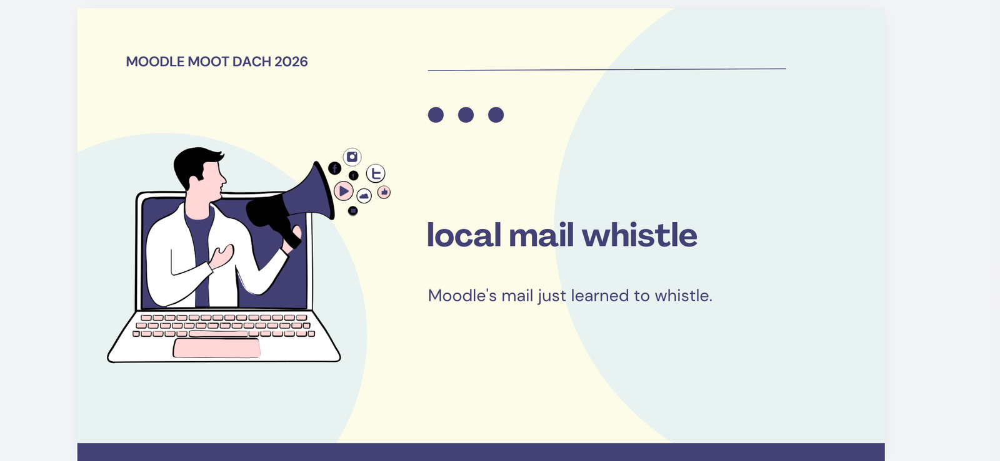
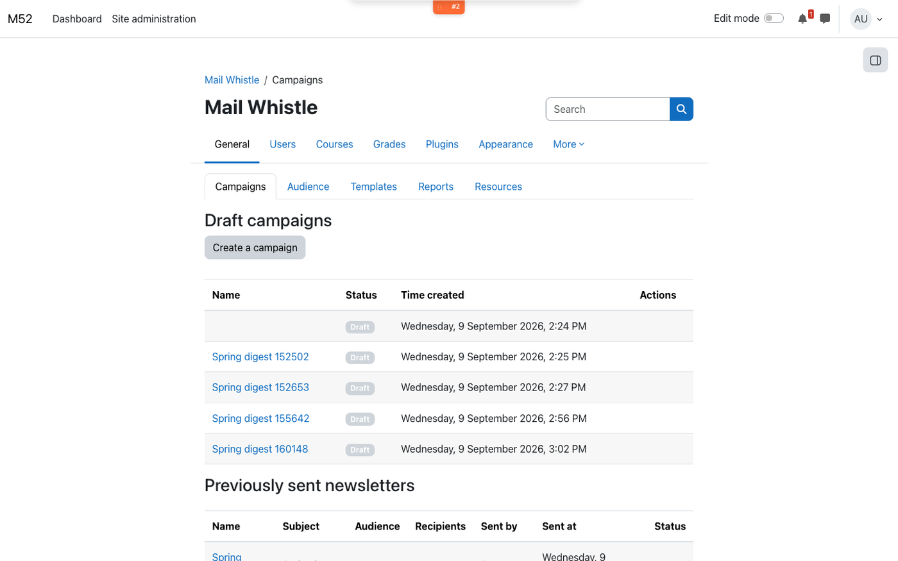
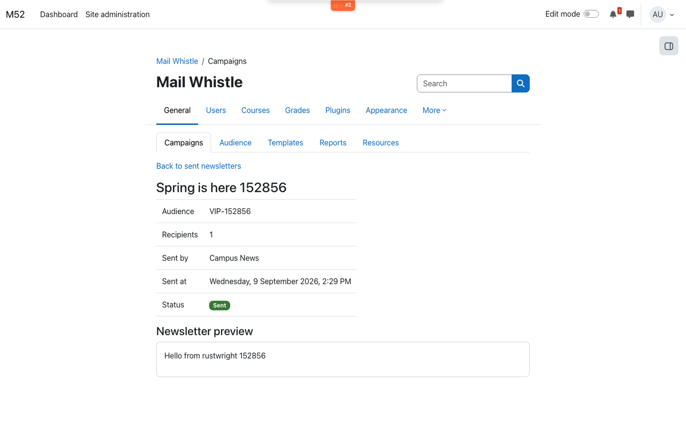
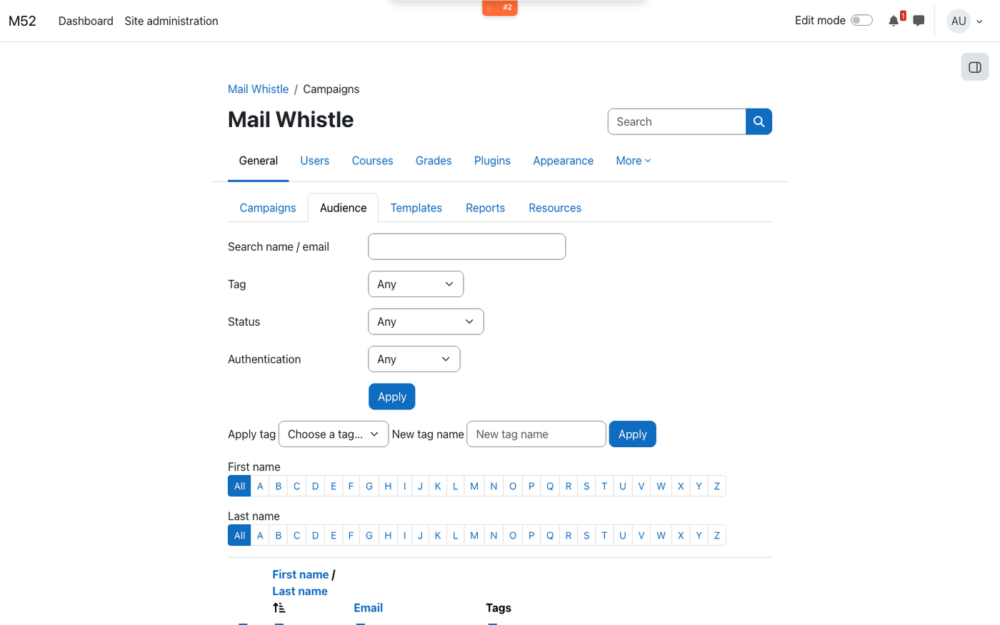
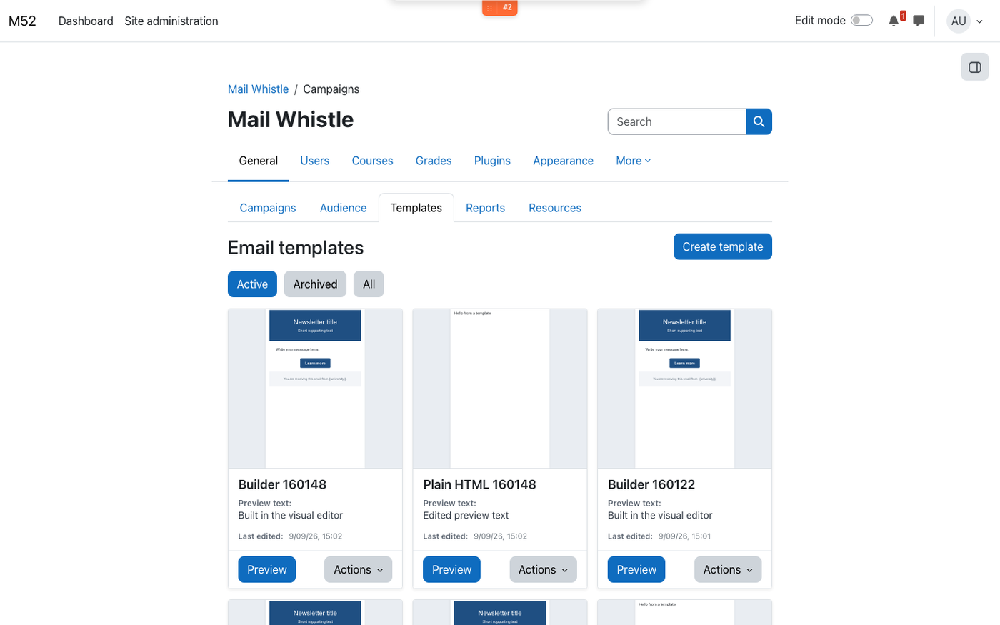
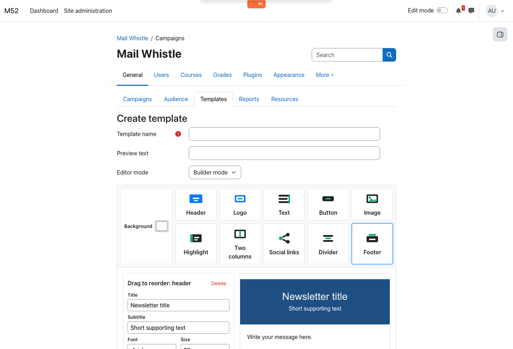

# Mail Whistle

**Moodle's mail just learned to whistle.**

Mail Whistle (`local_mailwhistle`) is a Moodle local plugin for sending newsletters and email campaigns to tagged audiences of site users. It is a **MoodleDach project** (MoodleMoot DACH community). Copyright belongs to the project, not to any one person or company.

> Status: early development (`MATURITY_ALPHA`). Moodle **4.5 LTS through 5.2+**.

Introduced at [Moodle Moot DACH 2026](https://canva.link/p1zpn7lg7fyuisx).

## Why it exists

Moodle already has messaging, but it is built for notifications, not campaigns. Mail Whistle adds a small admin workspace for:

- building HTML newsletters (visual builder or raw HTML)
- targeting people with reusable audience tags
- sending test copies to selected reviewers before the real send
- scheduling campaigns for a future date and time
- delivering in batches through Moodle's email processor while respecting campaign notification settings
- recording opens and clicks without requiring a Moodle session in the inbox
- seeing who a campaign (and which template) was sent to, with open and click counts

Open it at **Site administration → Mail Whistle**, or `/local/mailwhistle/index.php`.

## What you can do today

| Area | Status |
|------|--------|
| Campaigns (draft → ready → send) | Working |
| Audience tags, filters, assign/remove | Working |
| Email templates + visual builder | Working |
| Test mail to selected reviewers | Working |
| Scheduled sending and cancellation | Working |
| Recipient unsubscribe and personal preferences | Working |
| Open / click tracking | Working |
| Image resources for templates | Working |
| Reports and analytics | Working |

### Campaigns

Drafts, scheduled campaigns and previously sent newsletters live on one tab. Create a campaign, walk through **Details → Content → Audience → Review**, send test copies, mark it ready, then choose **Send now** or **Schedule campaign**. Delivery runs as an ad-hoc task so large audiences can be batched.

Review shows current eligible and excluded recipient counts, exclusion reasons, and a paginated recipient preview with effective delivery addresses. The counts use the same account, opt-out, notification and address checks as sending, which are checked again before delivery. Review also explains missing content or unavailable attachments. A ready campaign can be returned to draft until sending starts. Sending and completed campaigns cannot be edited.

Use **Duplicate** in a campaign or report table to start a follow-up as a new draft. The copy keeps the subject, message, sender, attachment selections, template reference and audience rules, and opens for editing. It has no delivery history or scheduled send time. The original campaign stays unchanged. Recipients are selected again when the follow-up is sent, so current tag membership, opt-outs and notification preferences apply.

Scheduling uses your Moodle timezone. The **Scheduled for** column shows the planned time; **View schedule** lets you cancel before sending starts. Cancellation returns the campaign to Ready so it can be edited or rescheduled. Moodle cron checks due campaigns every minute; busy or stopped cron can delay delivery, but cannot start it early. The audience is selected when the scheduled send starts, so later tag changes and opt-outs apply. If content, resources or audience are no longer valid, the campaign changes to **Schedule needs review** without sending and explains what needs attention.

On Review, **Send test email** opens a Moodle dialog. Enter up to five addresses separated by commas, semicolons or newlines; the default is your current notification address. Each destination shows an accepted, failed-before-transport, or uncertain result. Copies use saved campaign content and your profile as sample personalisation, with no recipient snapshots, tracking or active unsubscribe links. Each manager can attempt up to 20 test addresses per rolling hour across campaigns and sessions. Site email diversion and your campaign notification eligibility still apply.

A sent campaign keeps its audience, recipient count, sender, time, and a preview of the HTML that went out.

### Audience

Tag users (for example `Newsletter` or `VIP`), then target a campaign at those tags. Filter the list by name/email, tag, active/suspended, and authentication method. Assign a new or existing tag to selected users; remove a tag from a user with a confirm step.

The campaign is sent to everyone tagged with **any** of the selected tags.

The **Campaign email preference** column and filter identify explicit opt-outs. These people remain visible for audience management but are excluded from sends. Suspended accounts also have a visible badge explaining that they will not receive mail. Adding a tag cannot override a recipient's choice; other account and notification settings are checked separately.

### Templates

Reusable layouts for the content step. HTML mode for a pasted body, or **Builder mode** for drag-and-drop blocks (header, logo, text, button, image, highlight, two columns, social links, divider, footer). Image and logo blocks pick a file uploaded on the Resources tab. Templates can be previewed, duplicated, archived, restored, exported as JSON, and deleted when unused.

**Duplicate** on a template opens a separate active copy in the same editor mode. **Import template** accepts a JSON file created by **Export JSON**, validates it, and creates a new template for review without replacing an existing template. Exports include layout and content, not uploaded image or document files. When importing on another site, check resource links and upload or select replacement files where needed.

Choose an editor before adding content. Saved templates keep that editor mode. **Save as HTML copy** converts the current Builder blocks into a separate editable HTML template and preserves the original. Blocks also have keyboard-accessible move controls.

Load a template into a campaign from the content step. Personalisation variables are filled at send time (a test copy uses the reviewer's profile, without tracking):

| Variable | Replaced with |
|---|---|
| `{{firstname}}` | Recipient first name |
| `{{lastname}}` | Recipient last name |
| `{{fullname}}` | First and last name |
| `{{email}}` | Recipient email |
| `{{sitename}}` | This Moodle site's full name |
| `{{siteurl}}` | This Moodle site's URL |
| `{{unsubscribe}}` | Recipient-specific unsubscribe confirmation URL; inactive in previews and test copies |

`{{university}}` is an older name for `{{sitename}}`. Unknown variables are removed so they never appear in the inbox. These are Mail Whistle variables, not Moodle text filters.

### Sending and tracking

- Outgoing mail uses Moodle's email processor. Campaign provider defaults, administrator locks, user preferences, account status and recorded opt-outs are checked before each email. Other notification channels do not determine whether an email succeeded.
- The sender display name is configurable; Moodle controls the From address. **Reply-to email address** sets the destination for replies.
- Campaigns can attach files uploaded on the Resources tab (one file as-is, several as `attachments.zip`).
- Missing files or disabled attachments block sending instead of silently dropping the attachment.
- The subject of a test copy is prefixed with `[Test]`.
- Live sends rewrite `http(s)` links through `click.php` and append a 1×1 open pixel (`pixel.php`). Tokens are HMAC-signed; click tokens are bound to the target URL (no open redirect).
- Every campaign includes an unsubscribe link in HTML and plain text, even if the author omits `{{unsubscribe}}`. Unsubscribe links are never click-tracked. Opening one shows a confirmation; only confirming stops future Mail Whistle campaign emails for the original recipient, including when the message was forwarded. No Moodle login is needed to unsubscribe. Users can allow campaign emails again in **Preferences → Mail Whistle email preferences**; other Moodle notification settings still apply.
- Opens are stored once per recipient; clicks once per distinct link. Concurrent tracking requests are deduplicated, and a recording failure does not block a verified click destination or the tracking pixel response.
- Batch size is configurable (**Site administration → Mail Whistle → Settings**, default 50). A scheduled task resumes pending work after a stalled send. Interrupted or unconfirmed transport attempts are marked **Uncertain** and are not automatically sent again.

### Reports

The Reports tab lists sent and in-progress campaigns with audience tags, the template that was loaded (when one was used), recipient count, unique opens, and unique clicks. Open a campaign to see the snapshotted roster: name, email, send status, whether that person opened or clicked, and any send error. Opens are stored once per recipient; clicks once per person (unique clickers). Campaigns sent before this version have no stored template id.

**Sent** means the email transport accepted the message, rather than confirmation that it reached an inbox. **Skipped** means account or notification settings prevented sending; **Uncertain** means acceptance could not be confirmed. Campaigns finish as Sent, Completed with issues, or Failed according to their recipient outcomes. **Retry failed recipients** retries only known failures; it leaves sent, skipped and uncertain recipients untouched.

Engagement counts and rates use confirmed sent recipients. Opens and clicks from uncertain deliveries appear separately, without changing their delivery status or inflating the rates.

Sending reports show when delivery was queued, elapsed time, the latest recipient activity, and any recorded worker retry. Background task details show the dispatcher and recovery task status, last run and next run; administrators can open task settings and logs. These records help investigate a delay but do not prove that a worker is currently running. Refresh the page for updated information.

A sent-campaign preview on the Campaigns tab links through to the same report.

### Resources

Upload images (JPEG, PNG, GIF, WebP) on the Resources tab, then choose them from **Uploaded image** on an Image or Logo block. You can still paste a URL for an external image. Resource images are public `pluginfile.php` links so they load in inboxes without a Moodle login.

PDFs and other documents uploaded there can be attached on the campaign content step. They are sent as email attachments, not as public URLs. Non-image files still require a Moodle login if opened from the site.

Resources show which saved campaigns or templates use them. Referenced files cannot be deleted or replaced, including images used by sent campaigns. Upload a new filename for a replacement and update the draft or template that needs it.

## Install

1. Copy this folder to `local/mailwhistle` in your Moodle tree (`public/local/mailwhistle` on Moodle 5.1+ with a `/public` docroot).
2. Visit **Site administration → Notifications** to run the install.
3. Purge caches.

The plugin adds a **Mail Whistle** category under site administration, with Campaigns and Settings.

When upgrading from a version before 1.5.0, finish any ongoing campaign sends and stop old cron workers before replacing the code. The upgrade marks historical failed deliveries, and any remaining recipients of an unfinished send, as Uncertain because the old sender could not establish whether email had already been accepted. It preserves the original error details and prevents those recipients from being sent again by recovery or retry. Draft and ready campaigns are unchanged.

Version 1.5.1 removes orphaned tracking events whose recipient, campaign or user no longer exists, including events recreated after a privacy deletion. Valid historical engagement is preserved. Links in previously sent emails still redirect after erasure, but no longer record engagement for the erased recipient.

## Capabilities

All capabilities are system-context. Default archetype: **manager**.

| Capability | Purpose |
|------------|---------|
| `local/mailwhistle:view` | Open the Mail Whistle pages |
| `local/mailwhistle:manage` | Create and send campaigns, manage templates and resources |
| `local/mailwhistle:managetags` | Create, assign, and remove audience tags |
| `local/mailwhistle:configure` | Change plugin settings (send batch size) |

## Privacy

Mail Whistle ships a GDPR privacy provider. It can export and delete campaign authorship, tag assignments, recipient snapshots, send logs, tracking events, and unsubscribes for a user. See `classes/privacy/provider.php`.

The test-copy allowance stores only recent attempt timestamps in a user preference, with no destination addresses. The privacy provider exports this preference too. Deleting a recipient snapshot invalidates its unsubscribe link.

## Development

- PHPUnit: `vendor/bin/phpunit --testsuite local_mailwhistle_testsuite` (from a Moodle tree with the plugin installed)
- Behat: scenarios under `tests/behat/` tagged `@local_mailwhistle`
- Coding style: `phpcs --standard=moodle .` (or [moodle-plugin-ci](https://github.com/moodlehq/moodle-plugin-ci))
- AMD: edit `amd/src/template_builder.js`, then `npx grunt amd --root=local/mailwhistle`

## Contributors

Everyone who works on Mail Whistle. See also the [contributors graph](https://github.com/moodlelocalmailwhistle/moodle-local_mailwhistle/graphs/contributors).

- Luca Bösch
- Amir Ahkami
- Davo Smith
- Meret Racz
- Júlia Verdaguer
- Luuk Verhoeven

## Copyright and license

Copyright 2026 onwards MoodleDach project.

GNU GPL v3 or later. See [LICENSE](LICENSE).

Title artwork from the Moodle Moot DACH 2026 presentation ([Canva](https://canva.link/p1zpn7lg7fyuisx)).
